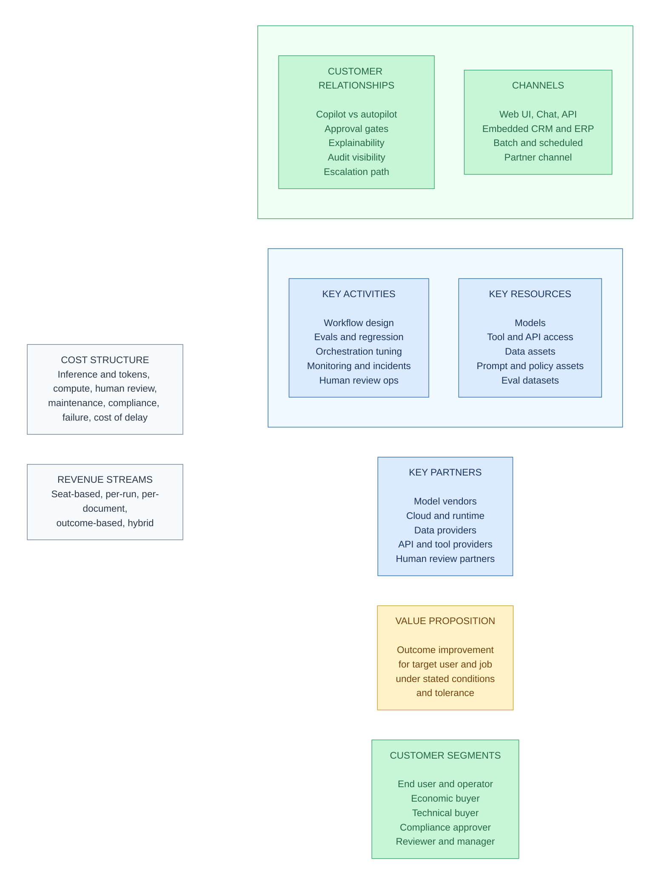
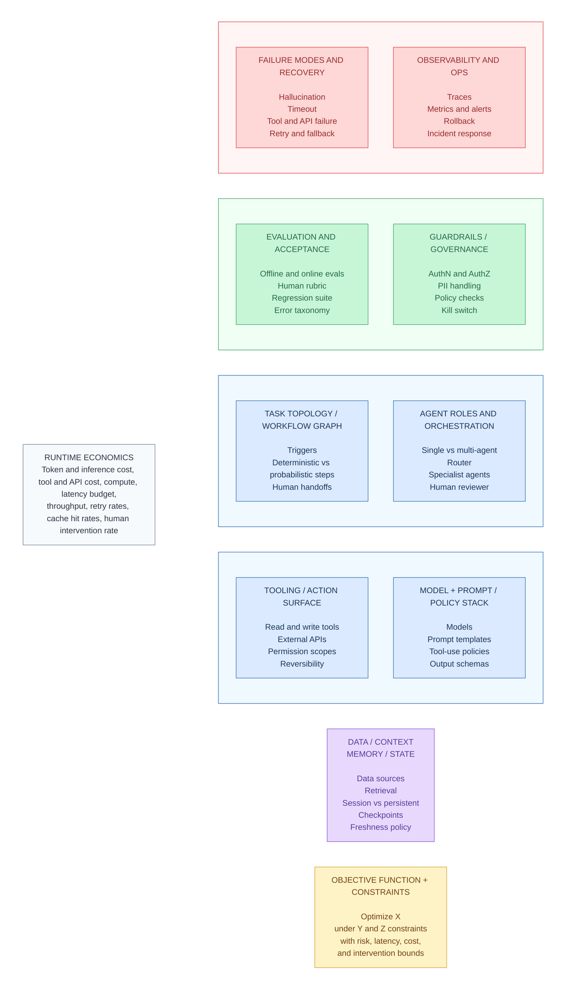
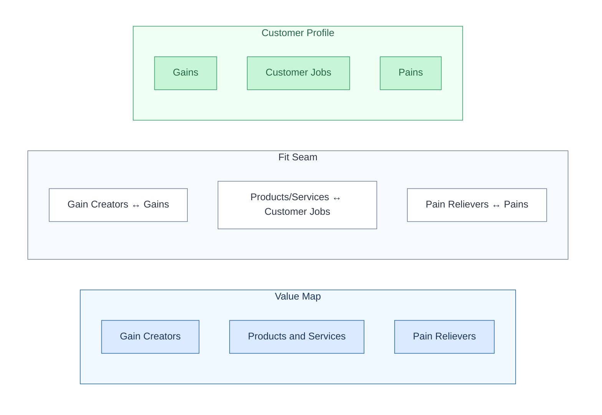
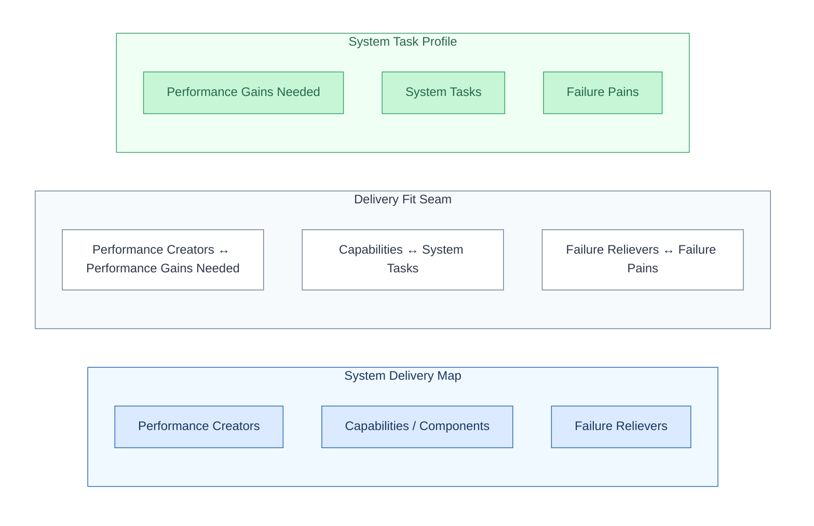

# Agentic Engineering Canvases (Consolidated)

This is a consolidated framework for adapting both the **Business Model Canvas (BMC)** and the **Value Proposition Design (VPD)** canvas to agentic products/systems.

It preserves three things that matter:

1. **Business vs engineering split** (to prevent promise-delivery disconnect)
2. **Spatial relationships / adjacency** (because touching boxes encode causal relationships)
3. **Traceability across canvases** (so value claims map to system mechanisms)

---

# Part I — Core principle

For agentic products, every canvas must be split into two synchronized layers:

* **Business layer** = market/workflow value and economic viability
* **Engineering layer** = delivery reality under constraints (quality, latency, cost, risk)

Use this rule:

* **Business** decides whether the product should exist
* **Engineering** decides whether the promise can be delivered repeatedly

If not split, teams produce a polished hallucination.

---

# Part II — Agentic Engineering BMC (paired canvases)

## A. Business Layer BMC (Agentic Business Model Canvas)

Keep the classic BMC geometry because it already encodes useful adjacency.

## Spatial layout (same as BMC)

### Left side (infrastructure / production side)

* **Key Partners** (full-height far-left column)
* **Key Activities** (top half of column 2)
* **Key Resources** (bottom half of column 2 — shares left border with Key Partners)

### Center

* **Value Proposition** (full-height center column)

### Right side (market / delivery side)

* **Customer Relationships** (top half of column 4)
* **Channels** (bottom half of column 4)
* **Customer Segments** (full-height far-right column — shares left border with CR and Channels)

### Bottom row (economics)

* **Cost Structure**
* **Revenue Streams**

### Add-on block (recommended)

* **Key Risks / Assumptions** (sidecar or footer-right)

This is not in the original BMC, but agentic products need it explicitly.

### Spatial diagram

Grid layout shows spatial adjacency — touching blocks encode direct causal relationships. Cost/Revenue divider aligns with the Value Proposition center. Color: blue = infrastructure, amber = value, green = market, gray = economics.

---

## Business Layer BMC — block definitions (agentic-adapted)

### 1) Key Partners

External dependencies that affect capability, cost, and risk.

Examples:

* Model vendors
* Cloud/runtime vendors
* Data providers
* API/tool providers
* Implementation partners
* Human review/annotation partners

### 2) Key Activities

What must be done to deliver and maintain value.

Examples:

* Workflow design
* Evals and regression ops
* Orchestration tuning
* Monitoring / incident response
* Integration work
* Human review operations
* Compliance controls

### 3) Key Resources

Assets/capabilities required to produce the service.

Examples:

* Models
* Tool/API access
* Data assets
* Prompt/policy assets
* Eval datasets
* Runtime/orchestration stack
* Observability stack
* Domain experts / reviewers

### 4) Value Proposition (Business-center)

The external promise to the user/buyer.

Form:

* outcome improvement
* target user/job
* conditions/tolerance

Example:

* “Reduce review cycle time by 50% while improving issue-detection consistency.”

This is a business promise, not an engineering metric.

### 5) Customer Relationships (Agentic trust/autonomy model)

How trust and control are structured.

Examples:

* Copilot vs autopilot vs advisory
* Approval gates
* Explainability expectations
* Audit visibility
* Escalation path

### 6) Channels

How the product reaches and embeds into workflow.

Examples:

* Web UI, chat UI, Slack, email
* API
* Embedded CRM/ERP step
* Batch/scheduled jobs
* Partner channel

### 7) Customer Segments

Who uses, pays, approves, and blocks.

Examples:

* End user/operator
* Economic buyer
* Technical buyer/admin
* Compliance/risk approver
* Reviewer/manager

### 8) Cost Structure (Business economics)

All costs to deliver value, including hidden AI costs.

Include:

* Inference/token costs
* Compute/storage/tool fees
* Human review/ops
* Engineering maintenance
* Compliance/security overhead
* Cost of failure/rework
* Cost of delay (latency impact on throughput/adoption)

### 9) Revenue Streams

How value is captured.

Examples:

* Seat-based
* Per-run / per-case
* Per-document
* Outcome-based
* Hybrid (platform + usage + services)

### 10) Key Risks / Assumptions (recommended add-on)

Examples:

* Users will trust evidence shown
* Unit economics works at target usage
* Compliance permits deployment pattern
* Vendor dependencies remain stable

---

## Business Layer BMC — spatial adjacency logic (what touching boxes mean)

This is the part most people ignore.

### Key Partners ↔ Key Activities

Partners change what work you must do.

* New API vendor may increase integration complexity
* Model vendor changes may force re-evals

### Key Partners ↔ Key Resources

Partners often *are* the source of key resources.

* Model/API/data vendors directly shape capability

### Key Activities ↔ Key Resources

Resources only create value through activities.

* Evals + runtime + reviewers are only useful if operated

### Left-side blocks ↔ Cost Structure

Partners, activities, resources all drive cost.

* Model choice, orchestration complexity, review burden, vendor pricing

### Value Proposition ↔ Key Activities / Resources

Your claimed outcome depends on engineering/ops reality.

* “Faster review” depends on workflow design, evals, reliability

### Value Proposition ↔ Customer Relationships

The promise must match trust mode.

* High-risk domains usually require approval gates and evidence

### Value Proposition ↔ Channels

Channel affects perceived and actual value.

* Slack chat may be convenient but weak for verification-heavy tasks

### Customer Relationships ↔ Channels

The interface shapes control and trust.

* Structured UI supports safer approval than free-form chat

### Channels ↔ Customer Segments

Different stakeholders use different surfaces.

* Admins may need dashboard; end users need embedded workflow

### Customer Segments ↔ Revenue Streams

Who values it affects pricing metric.

* Manager values throughput → per-case pricing may fit
* Enterprise buyer may prefer seat + SLA

### Value Proposition ↔ Revenue Streams

How value is framed determines monetization logic.

* “Drafting” often seat-priced
* “Completed validated case” may support outcome pricing

### Customer Relationships ↔ Customer Segments

Different segments demand different trust models.

* Enterprise segments typically require higher audit/approval controls
* SMB segments may accept more autonomous operation

### Value Proposition ↔ Cost Structure

The promise directly drives cost structure.

* Higher-accuracy promises require more expensive models, evals, and human review
* Mirrors Value Proposition ↔ Revenue Streams on the other side

### Cost Structure ↔ Revenue Streams

Unit economics viability — the two bottom-row blocks share a border.

* Revenue per unit must exceed cost per unit at target usage
* Margin analysis lives at this seam

### Channels ↔ Revenue Streams

Channel choice constrains monetization mechanics.

* API channel → usage-based pricing natural fit
* Embedded enterprise channel → seat-based + SLA natural fit

### Right-side blocks ↔ Revenue Streams

Parallel to “Left-side blocks ↔ Cost Structure.” Relationships, channels, and segments all shape revenue capture.

* Trust model affects willingness to pay (approval-gated may justify premium)
* Channel determines billing integration surface

---

## B. Engineering Layer BMC (Agentic Systems Business Model Support Canvas)

This is the systems twin of the BMC. It is not a replacement for systems architecture docs; it is a strategic engineering canvas that explains how the business promise is operationalized.

## Spatial layout (engineered to preserve adjacency logic)

### Left side (capability substrate — mirrors BMC left-side geometry)

* **Data / Context / Memory / State** (full-height far-left column — analog to Key Partners)
* **Tooling / Action Surface** (top half of column 2)
* **Model + Prompt/Policy Stack** (bottom half of column 2)

All three must touch because they co-determine agent behavior: policies govern tool use, data shapes prompts and retrieval, tools depend on permissions and context.

### Center-left (execution engine)

* **Task Topology / Workflow Graph** (top half)
* **Agent Roles & Orchestration** (bottom half)

### Center (delivery contract)

* **Objective Function + Constraints** (full-height center column — analog to Value Proposition)

### Right side (assurance / reliability side — 2×2 grid)

* **Evaluation & Acceptance** (top inner — center-adjacent)
* **Failure Modes & Recovery** (top outer)
* **Guardrails / Security / Governance** (bottom inner — center-adjacent)
* **Observability & Operations** (bottom outer)

This 2×2 arrangement ensures: Evals touches Failure Modes (top row), Observability touches Failure Modes (outer column), and both Evals and Guardrails touch the Objective Function center block (inner column).

### Bottom row (systems economics)

* **Runtime Economics** (cost, latency, throughput, intervention)

### Spatial diagram

Grid layout shows spatial adjacency — touching blocks encode direct system causality. Color: purple = data substrate, blue = execution pipeline, amber = delivery contract, green = inner assurance (center-adjacent), red = outer assurance, gray = economics.

---

## Engineering Layer BMC — block definitions

### 1) Tooling / Action Surface

What the system can read/write/do.

Include:

* Read tools, write tools, compute tools
* External APIs
* Permission scopes
* Reversible vs irreversible actions

### 2) Data / Context / Memory / State

How the system gets and retains context.

Include:

* Data sources
* Retrieval sources
* Session vs persistent memory
* Checkpoints/state transitions
* Freshness policy
* Provenance requirements

### 3) Model + Prompt/Policy Stack

Behavioral and capability control plane.

Include:

* Model(s)
* Prompt templates
* Tool-use policies
* Output schemas
* Refusal/abstention rules
* Versioning

### 4) Task Topology / Workflow Graph

The actual process graph.

Include:

* Triggers
* Deterministic vs probabilistic steps
* Branching and loops
* Stop conditions
* Human handoffs

### 5) Agent Roles & Orchestration

Who/what executes each step.

Include:

* Single-agent or multi-agent roles
* Router
* Specialist agents
* Reviewer agent
* Human reviewer placement

### 6) Objective Function + Constraints (Engineering-center)

Internal optimization contract.

Form:

* optimize X
* under Y/Z constraints
* with defined risk/latency/cost/intervention bounds

Example:

* “Maximize correctly supported issue flags under p95<20s, <$0.80/run, <15% mandatory escalations.”

### 7) Evaluation & Acceptance

How system quality is measured and released.

Include:

* Offline evals
* Online evals
* Human rubric
* Regression suite
* Release thresholds
* Error taxonomy
* Drift checks

### 8) Observability & Operations

How the system is monitored and maintained.

Include:

* Traces
* Metrics (quality, cost, latency, tool failures)
* Alerts
* Rollback/version control
* Incident response
* Postmortems

### 9) Failure Modes & Recovery

Expected failure classes and recovery actions.

Include:

* Hallucination
* Timeout
* Tool/API failure
* Stale context
* False positives/negatives
* Retry/fallback/escalation logic

### 10) Guardrails / Security / Governance

Controls preventing expensive mistakes.

Include:

* AuthN/AuthZ
* PII/secret handling
* Policy checks
* Output validation
* Sandboxing
* Audit logs
* Kill switch / degraded mode

### 11) Runtime Economics (Systems bottom row)

Operational unit economics and performance budgets.

Include:

* Token/inference cost by stage
* Tool/API cost by stage
* Compute/storage
* Latency budget by stage
* Throughput/concurrency
* Retry rates
* Cache hit rates
* Human intervention rate

---

## Engineering Layer BMC — spatial adjacency logic

### Substrate blocks (Tooling ↔ Data/Memory ↔ Model/Prompt)

These three must touch because they co-determine behavior.

* Policies govern tool use
* Data shape prompts and retrieval
* Tools depend on permissions and context

### Substrate ↔ Task Topology / Orchestration

Capabilities only matter through process design.

* Workflow graph decides when tools/models/context are used
* Orchestration determines role allocation and control flow

### Topology ↔ Orchestration

Task structure and role assignment are inseparable.

* Branching/loops often imply orchestrator complexity

### Execution engine ↔ Objective Function + Constraints

The objective is achieved through topology/orchestration choices.

* If objective changes, workflow graph usually changes

### Objective Function ↔ Evals / Guardrails / Runtime Economics

The center must touch these because constraints are measured and enforced through them.

* Evals: prove objective attainment
* Guardrails: enforce policy/risk constraints
* Runtime economics: enforce cost/latency constraints

### Evals ↔ Failure Modes

Failure taxonomy should drive eval design.

* If a failure is not in the taxonomy/evals, it is unmanaged

### Observability ↔ Failure Modes

Detection depends on instrumentation.

* No traces/metrics → no reliable detection

### Guardrails ↔ Tooling / Action Surface (cross-layout dependency, not spatial adjacency)

This is a logical dependency that spans the layout — Guardrails (right side) and Tooling (left side) are not physically adjacent. The relationship is mediated through the center blocks (Objective Function constrains what guardrails must enforce given the action surface).

* Write actions require stronger controls than read-only systems
* Action reversibility determines guardrail strictness
* Changes to the action surface must propagate through constraints to guardrail updates

### Assurance side ↔ Runtime Economics

Reliability has a cost.

* Validation, logging, retries, guardrails add latency and cost

### Everything upstream ↔ Runtime Economics

Runtime economics is the systems equivalent of BMC Cost Structure.

* Model choice, retries, loops, intervention, validations all land here

---

## C. Cross-layer BMC traceability (Business ↔ Engineering)

This is where the framework becomes useful.

Every business-layer claim should trace to engineering-layer mechanisms and thresholds.

### Trace mappings (required, canonical, and near-exhaustive)

A perfectly exhaustive mapping is impossible without a specific product, domain, and operating model. The list below is complete at the BMC block level and should be specialized per implementation.

* **Key Partners** → **Vendor and platform constraints, SLA dependencies, portability/lock-in controls, contingency plans**
* **Key Activities** → **Evals, release gates, incident response, orchestration and operations routines**
* **Key Resources** → **Models, data assets, tools/APIs, memory/state systems, runtime infrastructure**
* **Value Proposition** → **Objective Function + Constraints, acceptance thresholds, target reliability envelope**
* **Customer Relationships (trust mode)** → **Autonomy mode, HITL placement, guardrails, auditability and evidence UX**
* **Channels** → **Task triggers, interface contracts, integration topology, channel-specific latency/error budgets**
* **Customer Segments** → **Role-based access, persona-specific workflows, tenancy/isolation patterns, segment-specific SLA controls**
* **Cost Structure** → **Runtime economics, intervention rates, failure/rework rates, reliability overhead accounting**
* **Revenue Streams** → **Metering and billing instrumentation, throughput/SLA assumptions, unit economics targets**
* **Key Risks/Assumptions** → **Failure taxonomy, monitoring coverage, fallback/degraded modes, policy/compliance controls**

If a business box has no engineering trace, it is a wish.

---

# Part III — Agentic Engineering VPD (paired canvases)

VPD is often the better starting point for agentic products because agentic failures happen first at **job-fit**, **trust-fit**, and **verification-fit**.

Use a paired VPD to prevent “useful in demo, unusable in workflow.”

---

## A. Business Layer VPD (Agentic Market Fit VPD)

This preserves classic VPD structure but adds agentic-specific framing.

## Spatial layout (classic VPD)

### Left side — Value Map (square)

* **Gain Creators** (top)
* **Products & Services** (middle)
* **Pain Relievers** (bottom)

### Right side — Customer Profile (circle)

* **Gains** (top)
* **Customer Jobs** (middle)
* **Pains** (bottom)

### Center seam (fit relationship)

* Products/Services ↔ Customer Jobs
* Pain Relievers ↔ Pains
* Gain Creators ↔ Gains

### Add-on overlays (recommended)

* **Trust/Verification Requirements**
* **Error Severity**
* **Unit Economics Fit (business-level assumptions)**
* **Eval Acceptance Hooks (what must be proven)**

### Spatial diagram

Blue = value map, green = customer profile, gray = seam mapping. Row alignment across the seam encodes the core VPD fit hypotheses.

---

## Business Layer VPD — block definitions (agentic-adapted)

### 1) Customer Jobs (split explicitly)

Do not keep this generic. Split jobs into:

* **Execution jobs** (draft, summarize, classify, extract)
* **Decision jobs** (approve/reject/prioritize)
* **Validation jobs** (verify correctness/compliance/provenance)
* **Coordination jobs** (handoffs, routing, escalation)

This matters because AI often helps execution while making validation worse.

### 2) Pains

Include explicit trust and review burden.

Types:

* Time friction
* Cognitive load
* Tool switching
* Backlogs
* Error/rework cost
* Compliance exposure
* Reputation risk
* “I still have to check everything” burden

### 3) Gains

Include confidence and control, not just speed.

Types:

* Throughput
* Consistency
* Fewer omissions
* Faster approvals
* Higher confidence
* Reusable outputs/artifacts
* Safer delegation
* Better auditability

### 4) Products & Services (agentic product form)

Define what is actually delivered.

Examples:

* Copilot / autopilot / reviewer / orchestrator
* UI/API/embedded workflow
* Managed service + human review
* Output format (text/JSON/action/recommendation)

### 5) Pain Relievers (mechanisms, not slogans)

State concrete mechanisms.

Examples:

* Citation-backed retrieval
* Structured templates
* Constraint-aware generation
* Auto policy checks
* Confidence-based escalation
* Side-by-side diffs
* Deterministic calculators
* Fallback/retry paths

### 6) Gain Creators (net new capability mechanisms)

Examples:

* Batch processing
* Queue triage
* Consistency across cases
* Monitoring/alerts
* Trend analytics
* Reusable structured outputs
* Proactive routing

---

## Business Layer VPD — spatial adjacency logic

### Customer Jobs ↔ Pains

Pains arise in real workflow steps, not abstractly.

* Validation jobs often create hidden pain in agentic workflows

### Customer Jobs ↔ Gains

Desired gains differ by job type.

* Decision jobs often value confidence > speed

### Pains ↔ Gains

Some gains are just pain removal; others are net new capability.

* Important distinction for pricing and adoption

### Products & Services ↔ Pain Relievers

Product form determines whether pain relief is real.

* Free-form chat may reduce drafting pain but worsen verification pain

### Products & Services ↔ Gain Creators

Autonomy mode and integration shape gain magnitude.

* Embedded reviewer may create more adoption than standalone assistant

### Pain Relievers ↔ Gain Creators

Some mechanisms do both; some create gains but also new pains.

* More flags can increase safety and false-positive fatigue simultaneously

### Cross-seam fit (the main VPD fit)

* Products/Services (left-square) ↔ Customer Jobs (right-circle)
* Pain Relievers (left-square) ↔ Pains (right-circle)
* Gain Creators (left-square) ↔ Gains (right-circle)

### Agentic hidden fit (must be explicit)

* Trust burden / error severity ↔ autonomy mode / verification mechanisms

That hidden fit is where most AI products break.

---

## B. Engineering Layer VPD (Agentic Delivery Fit VPD)

This is the systems counterpart to VPD. It ensures the user-facing pain relievers and gains are physically deliverable at acceptable cost/risk.

## Spatial layout (VPD-mirrored)

### Left side — System Delivery Map (engineering analog to Value Map — square)

* **Performance Creators** (top)
* **Capabilities / Components** (middle)
* **Failure Relievers** (bottom)

### Right side — System Task Profile (engineering analog to Customer Profile — circle)

* **Performance Gains Needed** (top)
* **System Tasks** (middle)
* **Failure Pains** (bottom)

### Center seam (delivery fit relationship)

* Capabilities ↔ System Tasks
* Failure Relievers ↔ Failure Pains
* Performance Creators ↔ Performance Gains Needed

### Add-on overlays (required)

* **Objective Function + Constraints**
* **Guardrails / Governance**
* **Eval Acceptance Criteria**
* **Runtime Economics Thresholds**

### Spatial diagram

Blue = system delivery map, green = system task profile, gray = seam mapping. Row alignment across the seam encodes delivery fit relationships.

---

## Engineering Layer VPD — block definitions

### 1) System Tasks

What the system must actually do to support the user workflow.

Examples:

* Retrieve
* Extract
* Compare
* Classify
* Draft
* Score confidence
* Route/escalate
* Validate schema
* Log evidence

These are not the same as user jobs, but they must support them.

### 2) Failure Pains

Engineering-side failure conditions that break user value.

Examples:

* Hallucination
* Tool/API failure
* Timeout
* Stale data
* Schema break
* False positives/negatives
* Over-escalation
* Under-escalation
* Cost spikes

### 3) Performance Gains Needed

What the system must improve to make the business promise true.

Examples:

* Accuracy / precision / recall
* Citation coverage
* p95 latency
* Throughput
* Cost/run
* Intervention rate
* Calibration quality
* Robustness under load

### 4) Capabilities / Components

The delivery machinery.

Examples:

* Models
* Retrieval stack
* Deterministic tools
* Orchestrator
* Prompt/policy templates
* Memory/state handling
* Validation layer
* Human review interface

### 5) Failure Relievers

Mechanisms that reduce failure impact/frequency.

Examples:

* Schema validation
* Citation enforcement
* Retries/timeouts/fallback models
* Tool health checks
* Confidence thresholds
* HITL gates
* Deterministic checks
* Canary release / rollback

### 6) Performance Creators

Mechanisms that improve economics and performance.

Examples:

* Model routing
* Caching
* Batching
* Precomputation
* Retrieval optimization
* Context pruning
* Parallelization
* Prompt compression
* Queueing strategies

---

## Engineering Layer VPD — center seam and overlays

### Center seam (delivery fit)

This is the engineering equivalent of VPD fit:

* Can capabilities perform the system tasks?
* Do failure relievers materially reduce failure pains?
* Do performance creators achieve the needed gains without creating new failure pains?

### Overlay 1 — Objective Function + Constraints (required)

This is the engineering center contract for the VPD pair.

Form:

* optimize user-relevant delivery metric(s)
* under cost/latency/risk/intervention constraints

### Overlay 2 — Guardrails / Governance

Ensures performance gains do not violate risk boundaries.

### Overlay 3 — Eval Acceptance Criteria

Defines what “fit” means in measurable terms.

* false positive rate threshold
* citation coverage threshold
* latency SLA
* intervention rate threshold

### Overlay 4 — Runtime Economics Thresholds

Connects engineering fit to business viability.

* cost/run ceiling
* cost-to-serve at expected usage
* exception handling burden

---

## Engineering Layer VPD — spatial adjacency logic

### System Tasks ↔ Failure Pains

Failures are task-specific.

* Retrieval tasks create stale/missing-evidence failures
* Classification tasks create false-positive/negative failures

### System Tasks ↔ Performance Gains Needed

Performance targets depend on task type.

* Decision support tasks need calibration and evidence
* Batch triage tasks need throughput and queue latency

### Failure Pains ↔ Performance Gains Needed

Performance optimization can worsen failure profiles.

* Lower latency via smaller model may increase omission risk

### Capabilities ↔ Failure Relievers

Failure controls depend on the components in use.

* Tool-heavy systems need health checks and retries
* Write-enabled systems need stronger validation and approvals

### Capabilities ↔ Performance Creators

Optimization opportunities depend on architecture.

* Caching/batching require predictable task patterns and state design

### Failure Relievers ↔ Performance Creators

These often trade off.

* More validation lowers failure risk but can increase latency/cost

### Overlays ↔ all blocks

Objective, guardrails, evals, and economics constrain what counts as “fit.”

---

## C. Cross-layer VPD traceability (Business ↔ Engineering)

This is the anti-disconnect mechanism you asked for.

### Required trace mappings

* **Business Customer Jobs** → **Engineering System Tasks**
* **Business Pains** → **Engineering Failure Pains + performance targets**
* **Business Gains** → **Engineering Performance Gains Needed**
* **Business Products/Services** → **Engineering Capabilities/Components + autonomy pattern**
* **Business Pain Relievers** → **Engineering Failure Relievers + verification UX mechanisms**
* **Business Gain Creators** → **Engineering Performance Creators + architecture choices**

### Additional required bridges (agentic-specific)

* **Trust/verification requirements** → citation/provenance, evidence UX, confidence calibration
* **Error severity** → autonomy mode, guardrails, human gate placement
* **Unit economics fit assumptions** → runtime cost/latency/intervention thresholds
* **Eval hooks** → measurable acceptance criteria in engineering VPD

If a business pain reliever has no engineering mechanism, it is marketing copy.

---

# Part IV — Spatial relationship summary across all four canvases

You asked specifically about spatial relationships. Here is the consolidated logic.

## 1) Business BMC spatial logic

* Left = production infrastructure
* Center = market promise
* Right = market delivery/relationship
* Bottom = economics

Touching means direct business causality.

## 2) Engineering BMC spatial logic

* Left = capability substrate
* Center-left = execution engine
* Center = delivery contract (objective + constraints)
* Right = assurance/reliability machinery
* Bottom = runtime economics

Touching means direct system causality.

## 3) Business VPD spatial logic

* Left = offered value mechanisms (square: products, pain relievers, gain creators)
* Right = user workflow reality (circle: jobs, pains, gains)
* Seam = fit hypotheses
* Overlays = trust, severity, economics, evidence requirements

Touching means direct user-value causality.

## 4) Engineering VPD spatial logic

* Left = delivery mechanisms (square: components/controls/optimizers)
* Right = machine-work reality (circle: tasks/failures/performance needs)
* Seam = delivery fit hypotheses
* Overlays = objective, guardrails, evals, economics thresholds

Touching means direct delivery causality.

---

# Part V — How the canvases connect (full traceability stack)

Use the canvases in this order and connect them vertically.

## Sequence

1. **Business VPD** — validate user/job/pain/gain fit
2. **Engineering VPD** — validate delivery fit under constraints
3. **Business BMC** — validate business viability/capture
4. **Engineering BMC** — validate operationalized delivery/economics/reliability

This order avoids premature business-model design for something users will not trust or adopt.

## Vertical trace links (must be explicit)

### VPD → BMC (business side)

* Customer Jobs/Pains/Gains → Value Proposition
* Product form → Channels + Relationships
* Trust requirements → Customer Relationships
* Willingness-to-pay / usage pattern → Revenue Streams
* User pain economics → Cost and pricing assumptions

### VPD → BMC (engineering side)

* System tasks/failure pains → Task topology + failure modes
* Capabilities/components → Resources / tooling/model stack
* Failure relievers → Guardrails + recovery + evals
* Performance creators → Runtime economics + orchestration
* Engineering fit thresholds → Objective function + constraints

### Business ↔ Engineering links (across both BMC and VPD)

* Value proposition ↔ objective function + constraints
* Trust mode ↔ guardrails/HITL/evidence UX
* Cost structure ↔ runtime economics + intervention + failure/rework rates
* Gain claims ↔ eval thresholds and observed metrics

---

# Part VI — Practical canvas templates (usable)

## 1) Agentic Business VPD (one page)

**Left (Value Map — square)**

* Gain Creators (top — specific mechanisms)
* Products & Services (middle — product form + autonomy mode)
* Pain Relievers (bottom — specific mechanisms)

**Right (Customer Profile — circle)**

* Gains (top — including confidence/control)
* Customer Jobs (middle — execution / decision / validation / coordination)
* Pains (bottom — including trust/review burden)

**Overlay strip**

* Trust/Verification requirements
* Error severity classes
* Usage assumptions
* Early eval proof points

---

## 2) Agentic Engineering VPD (one page)

**Left (System Delivery Map — square analog)**

* Performance Creators (top)
* Capabilities / Components (middle)
* Failure Relievers (bottom)

**Right (System Task Profile — circle analog)**

* Performance Gains Needed (top)
* System Tasks (middle)
* Failure Pains (bottom)

**Overlay strip**

* Objective function + constraints
* Guardrails
* Eval acceptance criteria
* Runtime economics thresholds

---

## 3) Agentic Business BMC (one page)

**Classic BMC layout (5-column grid — see diagram)**

* Key Partners (full height) | Key Activities (top) / Key Resources (bottom) | Value Proposition (full height) | Customer Relationships (top) / Channels (bottom) | Customer Segments (full height)
* Cost Structure (bottom-left) | Revenue Streams (bottom-right)
* Key Risks / Assumptions (sidecar or footer-right)

---

## 4) Agentic Engineering BMC (one page)

**Systems geometry (mirrors BMC column structure — see diagram)**

* Data/Context/Memory (full height) | Tooling (top) / Model+Prompt (bottom) | Task Topology (top) / Orchestration (bottom) | Objective Function (full height) | Evals (top-inner) / Failure Modes (top-outer) / Guardrails (bottom-inner) / Observability (bottom-outer)
* Runtime Economics (bottom row)

---

# Part VII — Design rules (to preserve fidelity)

## Rule 1: Every block must have adjacency logic

For each block, define:

* what it touches directly
* what changes propagate if it changes
* what cost/risk boundary it influences

If no adjacency is clear, it is probably a note, not a block.

## Rule 2: Every business claim must have an engineering mechanism

No exceptions.

## Rule 3: Every engineering optimization must trace back to user value or business economics

Otherwise you optimize the wrong thing.

## Rule 4: Trust and verification are first-class design elements

Do not hide them inside “UX” or “compliance.”

## Rule 5: Latency belongs in both layers, but differently

* **Business:** cost of delay / abandonment / trust decay / SLA risk
* **Engineering:** stage budgets / bottlenecks / throughput / retries

## Rule 6: Token cost is never the whole cost model

Track:

* direct compute/inference cost
* human intervention cost
* failure/rework cost
* reliability overhead
* cost of delay

---

# Part VIII — Compressed mapping cheatsheet

## BMC center relationship

* **Business BMC Value Proposition** = external promise
* **Engineering BMC Objective Function + Constraints** = internal delivery contract

Related, not identical.

## VPD center relationship

* **Business VPD fit** = user value fit
* **Engineering VPD fit** = deliverability fit under constraints

Both required.

## Most common failure mode this framework prevents

A product team says:

* “Users want faster output”
  Engineering delivers:
* “Fast drafts”
  Reality:
* review burden doubles, trust drops, margins collapse

This framework forces the hidden variables onto the canvas.

---

# Final consolidated view (single sentence)

Use **paired VPDs** to prove user-value fit and delivery fit, then **paired BMCs** to prove business viability and operational reliability—while preserving spatial adjacency in each canvas and trace links across all four so the value proposition is a promise engineering can actually cash.
